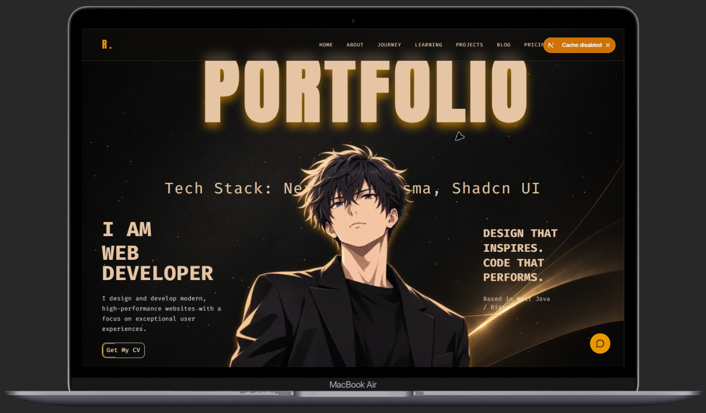
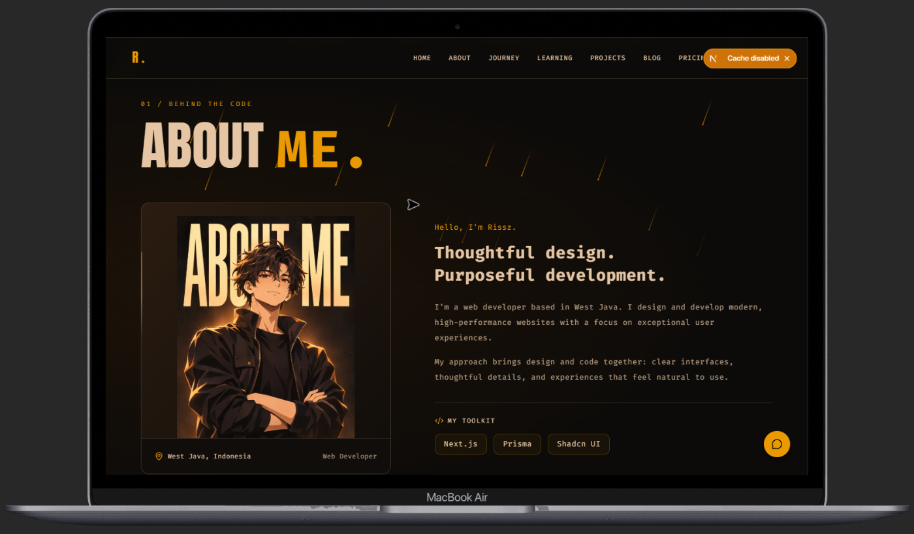
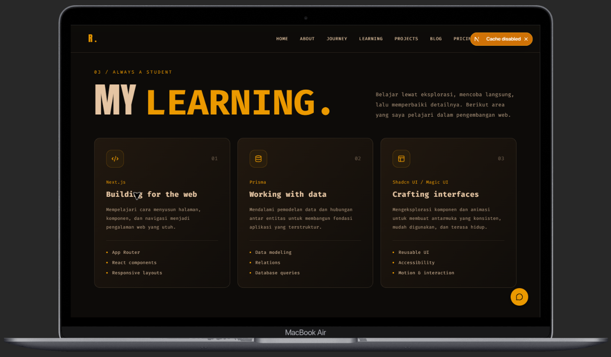
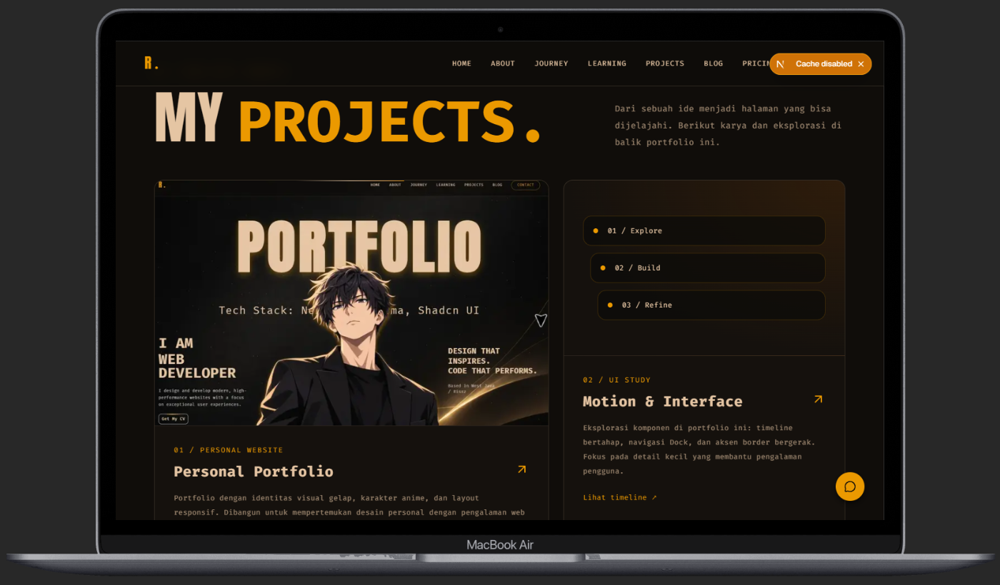
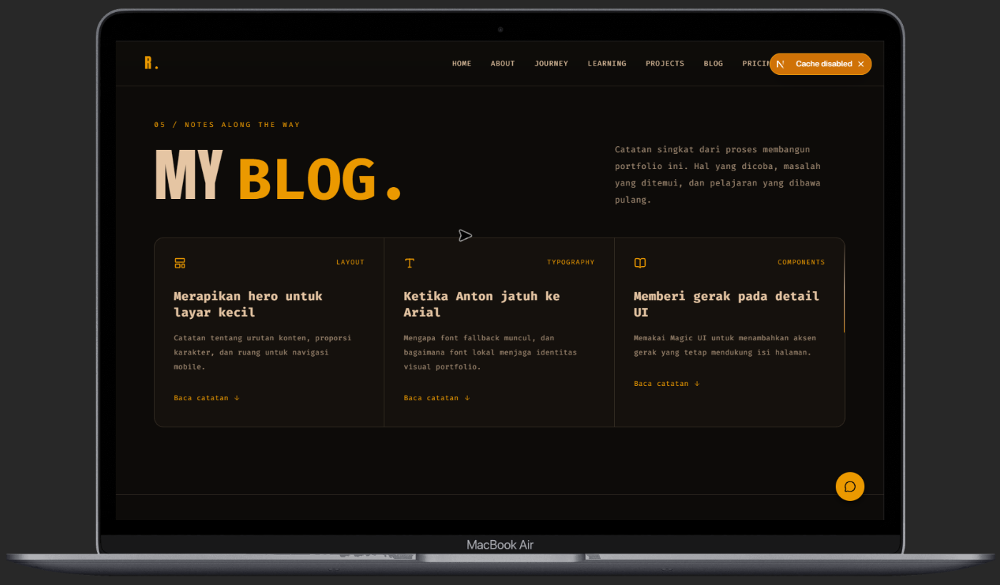
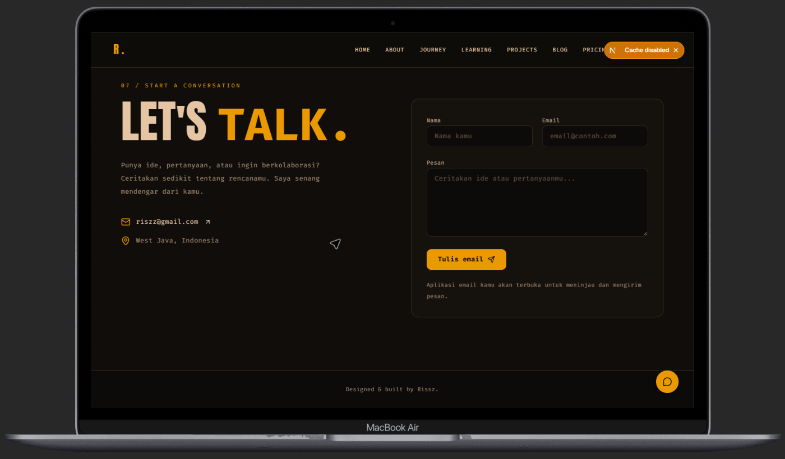
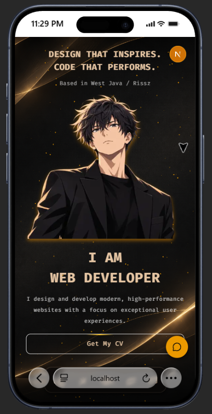
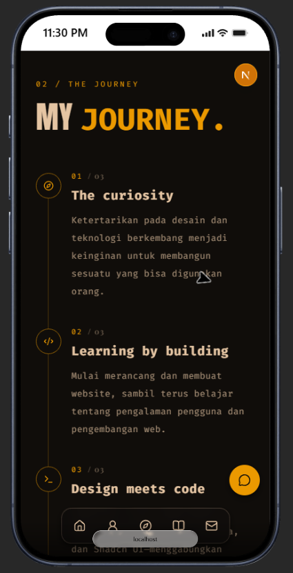

# Rissz — Personal Portfolio

Website portfolio pribadi dengan tema gelap, aksen emas, ilustrasi karakter anime, dan tampilan responsif. Menampilkan profil, perjalanan belajar, proyek, catatan pengembangan, layanan, serta asisten AI untuk berinteraksi dengan pengunjung.



## Fitur

- **Hero & About Me** — perkenalan, identitas visual, dan toolkit developer.
- **My Journey & My Learning** — timeline perjalanan dan bidang yang sedang dipelajari.
- **Projects & Blog** — karya portfolio dan catatan proses pengembangan.
- **Pricing** — informasi paket layanan pembuatan website.
- **Contact** — formulir yang membuka aplikasi email melalui `mailto:` untuk meninjau dan mengirim pesan.
- **AI Assistant** — percakapan dengan respons streaming melalui OpenRouter.
- **Interaksi visual** — opening loader, scroll reveal, partikel, kursor kustom, dan navigasi dock pada layar kecil.

## Galeri website

Screenshot berikut sudah dipotong untuk menghilangkan tab browser, toolbar luar mockup, dan taskbar Windows. Bingkai perangkat dipertahankan.

### Desktop

| About Me | My Learning |
| --- | --- |
|  |  |

| Projects | Blog |
| --- | --- |
|  |  |



### Mobile

<p align="center">
  
  
</p>

Gambar asli tersedia di [`docs/images`](docs/images), sedangkan hasil crop berada di [`docs/images/cropped`](docs/images/cropped). File `mobile-hero.png` merupakan referensi desain, sehingga tidak ditampilkan sebagai screenshot implementasi website.

## Tech stack

| Kebutuhan | Teknologi |
| --- | --- |
| Framework | Next.js 16.4.5 dengan App Router, React 19.3 |
| Bahasa | TypeScript |
| Styling | Tailwind CSS 4, tw-animate-css |
| Komponen UI | shadcn/ui, Base UI, komponen Magic UI, Lucide React |
| Animasi | Motion |
| Form & validasi | React Hook Form, Zod |
| AI | AI SDK, `@ai-sdk/react`, OpenRouter provider |
| Font | Anton SC lokal, Playfair Display, Fira Code |

Prisma disebut dalam konten toolkit/pembelajaran; repository ini belum memiliki integrasi database Prisma.

## Menjalankan secara lokal

Siapkan Node.js yang memenuhi persyaratan versi Next.js terpasang dan npm.

1. Instal dependency sesuai lockfile:

   ```bash
   npm ci
   ```

2. Untuk menggunakan asisten AI, buat `.env.local` di root project:

   ```dotenv
   OPEN_ROUTER_API_KEY=isi_api_key_openrouter
   OPENROUTER_MODEL=provider/model-id
   ```

   Isi `OPENROUTER_MODEL` dengan ID model yang tersedia untuk akun OpenRouter. Halaman portfolio dapat dibuka tanpa konfigurasi ini; percakapan AI memerlukan konfigurasi yang valid. Simpan API key di server; `.env.local` sudah diabaikan oleh Git.

3. Jalankan development server:

   ```bash
   npm run dev
   ```

4. Buka [http://localhost:3000](http://localhost:3000).

## Perintah

| Perintah | Kegunaan |
| --- | --- |
| `npm run dev` | Menjalankan development server |
| `npm run lint` | Menjalankan ESLint |
| `npm run build` | Membuat build produksi |
| `npm start` | Menjalankan hasil build produksi |
| `npm run test:ai` | Mengirim permintaan uji langsung ke OpenRouter |

Script `test:ai` membaca **`OPENROUTER_API_KEY`**, sedangkan endpoint aplikasi membaca **`OPEN_ROUTER_API_KEY`**. Jika menjalankan script tersebut, tambahkan `OPENROUTER_API_KEY` ke `.env.local` dengan nilai key yang sama. Pengujian ini membutuhkan koneksi internet dan dapat menggunakan kredit API.

## Struktur project

```text
app/
  api/chat/route.ts       # Endpoint percakapan AI
  section/               # Hero, profil, timeline, learning, proyek, blog, pricing, kontak
  globals.css            # Styling global
  layout.tsx             # Font, layout, header, loader, dan kursor
  page.tsx               # Susunan section halaman utama
components/
  ui/                    # Komponen UI dan efek visual
  ai-agent-popup.tsx     # Dialog dan formulir chat AI
  site-header.tsx        # Navigasi website
lib/                     # Utilitas bersama
public/
  fonts/                 # Font lokal
  images/                # Aset gambar website
docs/images/
  cropped/               # Screenshot untuk README
test/
  test-openrouter.ts     # Uji koneksi AI langsung
```

## Mengubah konten

- Ubah konten tiap bagian melalui `app/section/` dan urutannya melalui `app/page.tsx`.
- Ubah navigasi di `components/site-header.tsx`.
- Ubah alamat penerima email pada konstanta `email` di `app/section/contact.tsx`.
- Sesuaikan identitas dan instruksi asisten pada `app/api/chat/route.ts`.
- Atur metadata dan font di `app/layout.tsx`, lalu ganti aset website di `public/images/` sesuai kebutuhan.
